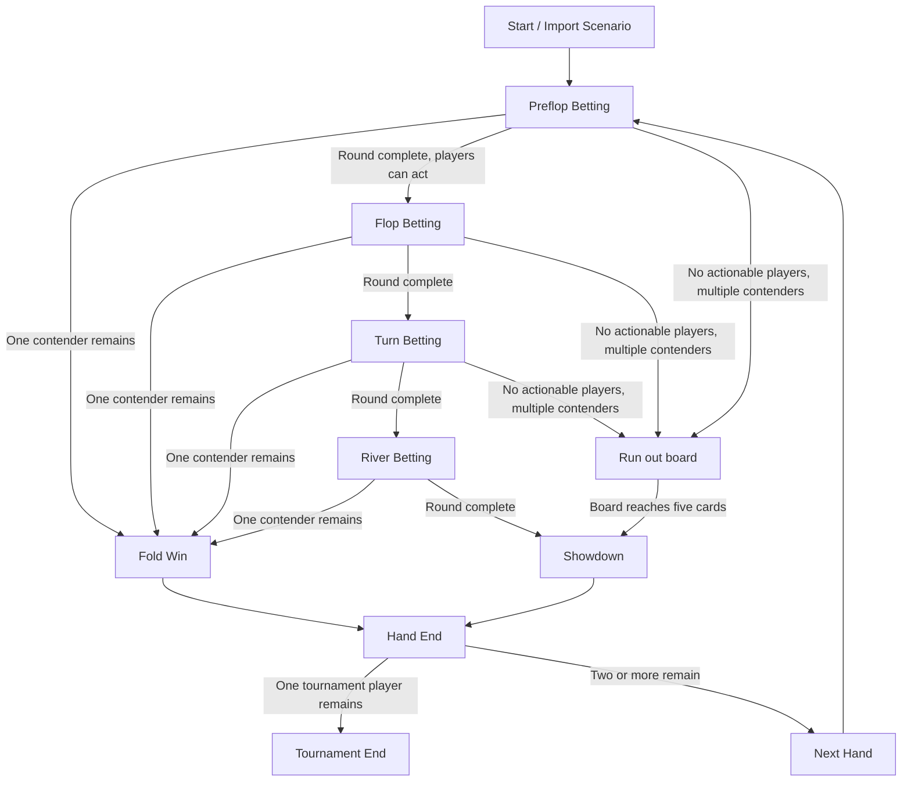

# MiniGame Stabilization Project — Audit

Status: **Initial code audit; no game-logic changes made in this document commit.**

Scope: `minigame/minigame.js`, `minigame/rules.js`, and `minigame/pots.js` on `main` at the time of this audit. This document records observed implementation separately from intended invariants. A behavior is not considered verified merely because it appears correct by inspection.

## 0. Domain Model

### Concepts and ownership

| Concept | Meaning | Current owner / representation | Notes |
|---|---|---|---|
| Tournament | Entire multi-hand session | Global state object `A` in `minigame.js` | No dedicated Tournament class/state type yet. |
| Hand | One deal through fold-win or showdown | Fields on `A`: `handNo`, `handOver`, `hand` data on each player, `awards` | Hand state and tournament state are interleaved. |
| Street | Preflop, flop, turn, river | `A.street` | Street progression is implemented by `street()`. |
| Action | Player decision and its state mutation | `act(seat, action, amount)` | Also writes history and advances the actor pointer. |
| Player | Seat, cards, stack and hand flags | Objects in `A.players` | Includes `seat`, `stack`, `out`, `fold`, `allin`, `contrib`, `showdownScore`. |
| Stack | Chips available to a player | `player.stack` | Modified by blinds, contributions and awards. |
| Street contribution | Chips put in during the current betting round | `A.roundBet[seat]` | Reset on street change. |
| Hand contribution | Total chips committed during this hand | `player.contrib` | Reset in `resetHand()`; cleared at hand end. |
| Pot | Chips currently committed and not yet awarded | `A.pot` | Incremented by `blind()` / `contribute()`; cleared after settlement. |
| Seed / dead pot | Initial pot supplied by analysis-to-game bridge | `A.basePot` | Added to the initial `A.pot`; passed separately to `settle()`. Must be treated as an explicit external chip source in conservation accounting. |
| Side pot | Contribution layer created by unequal total contributions | Derived inside `DealMiniGamePots.settle()` from `contrib` levels | Not persisted as a separate state object. |
| Board | Shared community cards | `A.board` | Grows from 0 to 3, 4, then 5 cards. |
| Hole cards | Two private cards per player | `player.hand` | CPU visibility is a UI rule; card identity remains in state. |
| Button / dealer | Seat with button priority | `A.dealer` | Tournament-level position, advanced at new hand. |
| Acting player | Seat expected to act next | `A.actor` | Mutable cursor; validity depends on player flags and round state. |
| Award | Chips returned to winners | `A.awards`, computed by `settle()` or fold-win | `settle()` returns awards without mutating stacks; caller applies them. |

### Ownership assessment

The state is currently a single mutable object, but not yet a strict canonical-state boundary: UI rendering reads `A`, while gameplay functions mutate its fields directly. `act()` combines legality checks, chip movement, action history and actor advancement. This is an audit finding about responsibility boundaries, not by itself a confirmed runtime defect.

## 1. State Inventory

| Field | Logical owner | Main writers | Main readers / consumers | Audit note |
|---|---|---|---|---|
| `A.street` | Hand | `resetHand()`, `startImported()`, `street()` | `advance()`, `ai()`, bet sizing, render | Transition state and UI label share one field. |
| `A.handNo` | Tournament | `resetHand()`, `startImported()` | render, CPU/EV seeds, async guards | Verify imported hand numbering and new-hand increments. |
| `A.dealer` | Tournament | `resetHand()`, `startImported()`, initial setup | blind assignment, action order, odd-chip priority | Heads-up and elimination cases need tests. |
| `A.actor` | Hand / betting round | `resetHand()`, `startImported()`, `act()`, `street()`, `advance()` | `advance()`, `human()`, render, EV | Must always be valid when a human action is requested. Sentinel `-1` is used when no action seat exists. |
| `A.acted[]` | Betting round | `resetHand()`, `street()`, `act()` | `Rules.roundComplete()`, `advance()` | Must be consistent with current bet after bets, raises and short all-ins. |
| `A.currentBet` | Betting round | `resetHand()`, `startImported()`, `act()`, `street()` | legal actions, AI, round completion, UI | Represents the highest street contribution that must be matched. |
| `A.lastRaise` | Betting round | `resetHand()`, `startImported()`, `act()`, `street()` | minimum raise calculation, AI, bet controls | Short all-in and reopening action rights need explicit tests. |
| `A.roundBet[]` | Betting round | `blind()`, `contribute()`, `street()`, `resetHand()`, `startImported()` | legality, call amount, round completion, EV | Per-street amount; not the same as total hand contribution. |
| `player.contrib` | Hand / player | `blind()`, `contribute()`, reset/end-hand paths | side-pot settlement, EV | Contribution layers must reconcile with the pot. |
| `player.stack` | Tournament / player | setup, `blind()`, `contribute()`, settlement awards, fold-win | legality, elimination, render | Must never be negative. |
| `player.fold/allin/out` | Hand or tournament status | `act()`, `resetHand()`, `nextHand()`, setup | rules, action legality, contenders, UI, settlement | Distinguish hand-folded, hand-all-in and tournament-eliminated states. |
| `A.pot` | Hand | `blind()`, `contribute()`, imported setup, settlement/end paths | fold-win, EV, render | Includes `basePot` for imported postflop scenarios. |
| `A.basePot` | Imported scenario / hand | `startImported()`, `nextHand()`, `restart()` | `showdown()`, total display message | Must be counted exactly once in settlement totals. |
| `A.board` | Hand | `resetHand()`, `startImported()`, `street()` | evaluator, EV, render | Legal lengths are 0, 3, 4, 5. |
| `A.handOver` | Hand lifecycle | `resetHand()`, `startImported()`, `endHand()`, `nextHand()` | `advance()`, UI, card reveal | A completed hand must not accept more actions. |
| `A.finished` | Tournament lifecycle | setup/restart, `finish()` | `advance()`, `human()`, UI | A finished tournament must not create another hand. |
| `A.pending` / `A.epoch` | Async CPU scheduling | `advance()`, reset/new-hand/import paths | CPU timeout callback | Stale callbacks must not mutate a newer hand. |
| `A.awards` | Hand result | fold-win and `showdown()` | render / payout summary | Sum of awards must equal the distributable pot. |

## 2. State Transition

### Intended lifecycle

This diagram is the intended lifecycle model; exact behavior and every edge still require tests. In particular, an all-in runout may traverse multiple streets automatically without betting actions.

### Observed call chain

- Human control calls `human(action)` → `act(0, action, amount)` → `advance()`.
- CPU scheduling occurs inside `advance()`; a timeout invokes `ai(player)`, then `act()`, then `advance()` again.
- `advance()` checks fold-win and `Rules.roundComplete(A)`; it then calls `street()` or `showdown()`, otherwise resolves the next action seat.
- `street()` deals the next board segment, resets street-level betting fields, selects the next action seat, renders and calls `advance()`.
- `showdown()` evaluates hands, calls `DealMiniGamePots.settle()`, applies awards to player stacks, sets `A.pot = 0`, then calls `endHand()`.
- `foldWin()` awards the full current `A.pot` to the only remaining contender, clears the pot and calls `endHand()`.
- `endHand()` clears per-player contributions and all-in flags, sets `handOver = true` and renders.
- `nextHand()` marks zero-stack players out, checks tournament completion, then starts the next hand.

### Transition audit questions

1. Can `advance()` recurse or return without either requesting a valid human action, scheduling a CPU action, progressing the street, or ending the hand?
2. Can `A.actor` point to a folded, all-in, eliminated or already-acted player while `A.awaiting` is true?
3. After a full raise, are all players who owe action marked as needing to act again?
4. After a short all-in raise, are action-reopening rules correct for players who already acted?
5. Does round completion handle a player who is all-in and has unmatched chips, as well as the case where all remaining contenders are all-in?
6. Are stale CPU timeouts prevented from acting after hand reset, import, restart or tournament end?
7. Does a hand with one contender end immediately, regardless of street or remaining board cards?

## 3. Hand Completion Rules

| Condition | Intended outcome | Current implementation path | Verification status |
|---|---|---|---|
| Only one non-folded, non-eliminated contender remains | Award current pot to that contender; end hand | `advance()` → `foldWin()` | Code path observed; tests not yet inventoried. |
| River betting round completes with multiple contenders | Evaluate hands and settle all pots | `advance()` → `showdown()` | Code path observed; payout invariants need tests. |
| Multiple contenders remain but no player can act (all are all-in or otherwise inactive) | Run out remaining board cards, then showdown | `Rules.allInRunout()` / `advance()` / `street()` | Edge cases need tests, including mixed all-in and folded players. |
| Tournament has one non-eliminated player | End tournament; do not deal another hand | `nextHand()` → `finish()` | Code path observed; tests not yet inventoried. |
| Player stack reaches zero after a hand | Mark player eliminated before next hand | `nextHand()` | Verify timing and all-in winner cases. |

A hand ending and a tournament ending are separate transitions. `handOver` must prevent further actions for the current hand; `finished` must prevent future hands.

## 4. Settlement Rules

### Observed settlement flow

1. `showdown()` evaluates `hand + board` for every player with `!out` (this includes folded players in the score list).
2. It calls `DealMiniGamePots.settle(all, scores, A.basePot || 0, A.dealer)`, where `all` is every non-eliminated player.
3. `settle()` derives contribution levels from positive `player.contrib` values. For each layer, participants are players whose contribution reaches that level; eligible winners are participants with `!fold`.
4. `settle()` splits each layer among the best-scoring eligible players and uses dealer-relative ordering for odd chips.
5. `settle()` returns `awards`, `distributed`, `contributed` and `potCount`. It does not directly mutate stacks.
6. `showdown()` applies awards to stacks, builds the result message, sets `A.pot = 0` and ends the hand.
7. Fold-win bypasses `settle()` and awards all of `A.pot` directly to the sole contender.

### Settlement responsibilities

Desired separation:
- Hand evaluation determines each eligible player's hand score.
- Pot settlement determines eligible winners for each contribution layer and the amount each receives.
- The hand lifecycle applies returned awards and closes the hand.

Current code keeps these responsibilities in separate functions, but `showdown()` currently performs evaluation, calls settlement, applies awards, formats result text and clears the pot. This is a boundary to keep small and testable; not yet classified as a defect.

### High-priority settlement checks

- Sum of all awards equals the full distributable pot, including the imported seed pot exactly once.
- Every award is a nonnegative integer; every award recipient is eligible to win the corresponding pot layer.
- Folded players contribute to pot layers but cannot win them.
- Side-pot eligibility is layer-specific; a player can win a lower layer without being eligible for a higher one.
- Ties split each layer independently; odd chips follow one explicit and tested priority rule.
- Uncalled excess contributions are returned or allocated according to a documented rule; they must not silently disappear or be awarded to an ineligible player.
- Missing scores, empty eligible sets, malformed contributions and unusual dead-pot inputs must fail safely or be handled by an explicit rule, not silently mask a mismatch.
- `distributed === contributed` must be a required postcondition, not merely a best-effort correction.

## 5. Invariants

These are proposed acceptance conditions. They are not claimed to be enforced by the current code.

### Mathematical invariants

1. **Chip conservation:** for a normal hand, `sum(player.stack) + A.pot` equals the initial chips in play. For imported scenarios, the accounting baseline must explicitly include the injected seed pot; do not compare against player stacks alone.
2. **Nonnegative values:** every stack, pot, contribution, street contribution and award amount is a finite nonnegative integer.
3. **Contribution accounting:** the current pot equals the seed pot plus chips contributed during the current hand, before settlement.
4. **Distribution completeness:** `sum(awards.amount) === distributablePot`; settlement must not underpay, overpay or fabricate chips.
5. **Post-settlement:** `A.pot === 0`; awards have been applied once; per-hand contributions are cleared only after settlement is complete.
6. **Side-pot accounting:** sum of all side-pot layers plus dead/seed pot equals total chips to distribute, after any explicitly defined return of unmatched contributions.
7. **Card validity:** no duplicate known cards; board length is 0, 3, 4 or 5; each dealt hand has two valid distinct cards.
8. **Integer accounting:** chips are integral; splitting and odd-chip handling preserve the total exactly.

### Game invariants

1. When `A.awaiting === true`, `A.actor` identifies an existing player who is not out, folded or all-in and whose action is currently legal.
2. A folded, all-in or eliminated player cannot take a new action.
3. A player with zero stack cannot make a new wager; any remaining response is constrained by the legal short-call/all-in rules.
4. A betting round cannot complete while an actionable player still owes a response or has not acted at the current contribution level.
5. A completed hand cannot accept actions; a finished tournament cannot start another hand.
6. With one contender remaining, the hand ends without requiring a showdown.
7. If multiple contenders remain and no one can act, the board runs out to five cards before showdown.
8. A player cannot receive chips from a pot layer for which they are not eligible.
9. CPU asynchronous callbacks from an older hand cannot mutate the current hand.
10. Exactly one hand lifecycle transition should be in progress at a time; repeated calls to advance/end-hand paths must not award chips twice.

## 6. Test Coverage

The repository's complete test inventory has **not yet been established** in this initial document pass. Do not interpret “not yet inventoried” as proof that no test exists. Before implementation repairs, locate the existing test commands and map every relevant test to the invariants below.

| Invariant / behavior | Existing test evidence at audit start | Required coverage | Status |
|---|---|---|---|
| Chip conservation across actions | Not yet inventoried | Check after blind, call, bet, raise, all-in, fold-win, showdown and next hand | Unknown |
| Acting-seat validity | Not yet inventoried | Table-driven action sequences, including skipped seats and all-ins | Unknown |
| Round completion / street progression | `rules.js` exposes pure helpers; test coverage not confirmed | Preflop → flop → turn → river, checks, calls, raises and short all-ins | Unknown |
| All-in runout | Not yet inventoried | Two or more contenders all-in on each street; folded players mixed in | Unknown |
| Fold-win settlement | Code path observed; automated coverage not confirmed | One contender remains on each street; pot awarded exactly once | Unknown |
| Main pot and side pots | `pots.js` has layered contribution settlement; test coverage not confirmed | Three-plus contribution levels, folded contributors, ties per layer | Unknown |
| Split pot / odd chips | Odd-chip ordering implemented in `pots.js`; test coverage not confirmed | Even split, odd split, dealer and non-dealer ties | Unknown |
| Settlement completeness | `settle()` returns `distributed` and `contributed`; test coverage not confirmed | Assert equality, not merely that the payout is at least a target | Unknown |
| Seed pot / imported scenario | `basePot` and `pot` both used; automated coverage not confirmed | Preflop and postflop imports; fold-win and showdown; no double count | Unknown |
| Tournament finish | Code path observed; test coverage not confirmed | One survivor; zero-stack elimination; no new hand after finish | Unknown |
| Stale CPU callback | Epoch/hand/actor guards present; test coverage not confirmed | Restart/import/next-hand before timeout callback | Unknown |
| Card uniqueness and board lengths | Import payload validator exists; broader deal coverage not confirmed | Duplicate cards, invalid lengths, deck exhaustion guards | Unknown |

Test implementation should favor pure unit tests for `rules.js` and `pots.js`, then integration tests for `minigame.js` transitions. Avoid tests that merely duplicate implementation logic; assert externally meaningful invariants and known poker outcomes.

## 7. Defect Candidates

Classification is intentionally conservative: a candidate is not a confirmed defect until a test or reproducible trace demonstrates a violation.

| Candidate | Initial status | Why inspect it | Evidence needed |
|---|---|---|---|
| Acting-player progression across `act()`, `advance()`, `roundComplete()` and `street()` | Suspected | Several functions share responsibility for the actor cursor and action-completion flags. | Deterministic action-sequence tests and actor trace. |
| `basePot` / `pot` / `contrib` accounting | Suspected | Imported postflop scenarios seed both `A.pot` and `A.basePot`; settlement receives `basePot` separately and adds hand contributions. | Conservation tests for imported fold-win and showdown paths. |
| Side-pot distribution completeness | Suspected | Settlement has fallback allocation when distributed chips are short. A fallback can hide a malformed layer/eligibility calculation instead of exposing it. | Layer-by-layer expected payouts, including folded contributors and ties. |
| Uncalled excess contribution handling | Unknown | Layer construction is contribution-level based; verify that excess chips are returned or allocated according to an explicit rule. | Unequal all-in stacks and a larger bet not called by any opponent. |
| Short all-in raise and action reopening | Suspected | `raiseLocked`, `acted` and minimum-raise state are updated in multiple branches. | Tests for full raise, short raise, multiple short raises and players who already acted. |
| All-in runout with no actionable seats | Suspected | `roundComplete()` uses active-player state and `advance()` also has a separate all-in runout branch. | Test every street with two or more contenders and no active players. |
| Tournament completion / elimination timing | Unknown | Zero stacks are marked out in `nextHand()`; end-of-hand state and winner selection are separate paths. | Full multi-hand tests through one remaining player. |
| Settlement fallback with no eligible winner / missing score | Unknown | `settle()` has fallback allocation paths for unallocated pots and a final completeness correction. | Explicit behavior tests for invalid or degenerate inputs. |

## 8. Repair Plan

1. **Complete inventory:** locate current test scripts and CI workflows; record the exact commands and results. Do not modify game logic during this step.
2. **Write deterministic failing tests:** begin with actor progression, seed-pot conservation and side-pot distribution completeness.
3. **Repair the smallest failing layer:** prefer `rules.js` for pure transition rules and `pots.js` for pure settlement rules. Touch `minigame.js` only when the integration boundary is responsible.
4. **Run targeted and full regression tests:** preserve all existing checks; report exact command and outcome.
5. **Run deterministic playthrough scenarios:** normal fold-win, check-down showdown, multiway pot, short all-in, multiway side pots, split pot/odd chip, imported scenario and tournament finish.
6. **Re-evaluate PR #29:** keep it open and undecided during the logic audit. After the engine stabilizes, rebase/recheck the layout changes and verify card visibility plus desktop/mobile layout against the updated main branch.
7. **UI re-evaluation:** only after the engine, transitions, settlement and regression checks are stable.

### Exit criteria

- Every proposed invariant is mapped to an automated test or a clearly documented reason it cannot be asserted directly.
- Chip conservation and settlement completeness are checked after every tested transition and at hand end.
- No known actor-transition, side-pot or imported-seed-pot failures remain.
- Full CI and deterministic playthrough scenarios pass.
- PR #29 is reviewed against the stabilized engine; it is merged, revised or closed based on evidence, not assumed accepted or rejected.

## Change log

- Initial audit document: documented the current code structure and audit questions only. No runtime logic or UI files changed.
